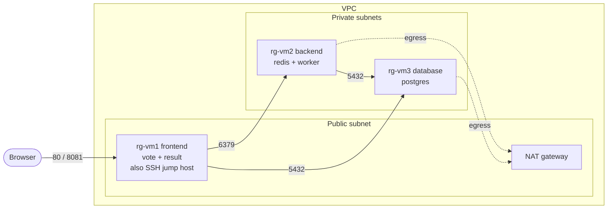

<!-- © 2024 | Ironhack -->
<!-- © 2026 | Rolando Garza -->

---

# Ironhack Project 1 — Multi-stack voting app on AWS

Polyglot voting application (Python, Node.js, .NET, Redis, PostgreSQL)
deployed on AWS Graviton instances with OpenTofu and Ansible.

> **AI-assistance disclosure:** this project was developed with the help of
> generative AI (code review, scripts, documentation drafts). All output was
> reviewed and tested by the author.

## Architecture



| Service | Language | Listens | Env vars (image default) |
|---|---|---|---|
| vote | Python | 80 | `REDIS_HOST` (`redis`), `REDIS_PORT` (`6379`) |
| result | Node.js | 80 (8081 on host) | `PG_HOST` (`db`), `PG_PORT` (`5432`), `PG_USER`/`PG_PASSWORD`/`PG_DATABASE` (`postgres`) |
| worker | .NET | none | `REDIS_HOST` (`redis`), `DB_HOST` (`db`), `DB_USERNAME`/`DB_PASSWORD`/`DB_NAME` (`postgres`) |
| redis | none | 6379 | none |
| postgres | none | 5432 | `POSTGRES_USER`, `POSTGRES_PASSWORD` |

Defaults match the compose service names. On EC2, override `REDIS_HOST` and `DB_HOST` with the private IPs.

## Repository layout

```text
vote/ result/ worker/   application sources (from the lab repository)
infra/                  OpenTofu: providers.tf variables.tf main.tf outputs.tf
ansible/                ansible.cfg hosts.ini (generated) playbook.yml
scripts/                bootstrap, gcli and cleanup scripts
docs/                   screenshots and presentation
```

## Prerequisites

- Debian 13 VM (KVM/libvirt) with: Podman (rootless), `qemu-user-binfmt`,
  OpenTofu >= 1.10, Ansible, AWS CLI v2, `gcli`
- AWS credentials for `eu-central-1`
- Docker Hub account and access token (`podman login docker.io`)
- `containers.podman` from ansible-galaxy; install with:
  ```sh
  ansible-galaxy collection install -r requirements.yml
  ```
- `pipx`, install with:
  ```sh
  sudo apt install pipx
  ```
- `ansible` and `checkov`, installable via:
  ```sh
  cat requirements.txt | xargs pipx install
  ```

## How to run

1. **Bootstrap** (key pair, S3 state bucket, `backend.hcl`, `terraform.tfvars`):
   ```sh
   tofu -chdir=bootstrap init && tofu -chdir=bootstrap apply   # once per account
   tofu -chdir=infra init -reconfigure -backend-config=backend.hcl
   ```
2. **Build and publish images** (multi-arch with `podman manifest`): `<see docs/images.md>`
   ```sh
   # something along the lines of:
   podman build --platform linux/amd64,linux/arm64 --pull=always --no-cache \
     --manifest docker.io/rolandog/worker:0.1.1 worker/
   podman manifest push --all docker.io/rolandog/worker:0.1.1
   ```
3. **Provision infrastructure:**
   ```
   tofu -chdir=infra plan
   tofu -chdir=infra apply
   ```
4. **Deploy with Ansible:**
   ```
   cd ansible
   ansible-playbook --check site.yml
   ansible-playbook site.yml
   ```
5. **Try it:** open `http://<frontend-ip>` (vote) and `http://<frontend-ip>:8081` (result)
6. **Tear down:**:
   ```
   ./scripts/rg-m2-cleanup.sh
   ./scripts/rg-m1-cleanup.sh
   ```


## Verification

`<AWS CLI commands and expected output; link to screenshots in docs/>`

## Project workflow

- Gitflow: `main`, `develop`, `feature/*`, `release/*`, `hotfix/*`
- One GitHub milestone per release (M1 = v0.1.0, M2 = v0.2.0, M3 = v0.3.0, M5 = v1.0.0)
- Issues carry `status:todo` / `status:doing` / `status:blocked` labels; closed = done

## Cost warning

The NAT gateway bills hourly while it exists.  Run the cleanup script after
every session and verify nothing billable remains.

## Credits and license

Based on the Ironhack voting-app lab: https://github.com/Pokfinner/ironhack-project-1.  License: Apache-2.0 license.
